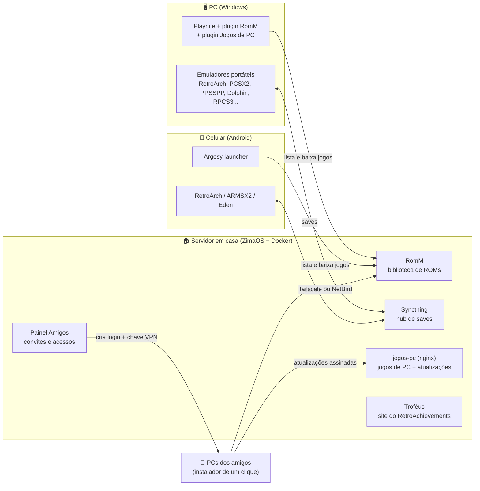

# 🎮 Homelab de Jogos Retro

[](https://github.com/LuizMartinez6/homelab-jogos-retro/actions/workflows/testes.yml)
[](https://github.com/LuizMartinez6/homelab-jogos-retro/actions/workflows/seguranca.yml)

**Uma central de videogames antigos para casa: um clique para instalar, os jogos num lugar só e o progresso salvo em todo aparelho.**

> **In English:** a one-click Windows installer (PowerShell 5.1 + WPF) and a Playnite plugin (C#) backed by a self-hosted Docker server. Highlights: RSA-signed auto-updates with atomic swap and rollback, resumable downloads, 400+ automated tests (Pester and pytest) that run the real scripts against a fake HTTP server, contract tests between components, and a CI pipeline with secret scanning, CodeQL and workflow linting. Code and docs are in Portuguese.

## 🤔 O que é isso?

Sabe quando você quer jogar um jogo antigo e precisa caçar programa, configurar controle, descobrir onde fica o save... e no PC de outra pessoa começa tudo de novo? Este projeto resolve isso.

Funciona como uma **"Netflix caseira" de jogos antigos**:

- 🏠 **Os jogos ficam num computador em casa** (o servidor), organizados com capa e nome, como numa loja.
- 🖱️ **Um instalador de um clique** prepara qualquer PC com Windows: instala os emuladores (os programas que rodam jogos de console no computador), a biblioteca e os controles. A pessoa não precisa saber nada de tecnologia.
- 💾 **O progresso acompanha você.** Começou no PC e quer continuar no celular? O save vai junto, sozinho.
- 👥 **Os amigos entram por convite.** Cada um recebe um código, cola no instalador e pronto. Dá para tirar o acesso de qualquer um a qualquer hora.
- 🏆 **Extras:** jogar online com os amigos, conquistas (troféus) e um ranking da turma.

## ⚙️ Como funciona, em 4 passos

1. **O dono** monta o servidor em casa e coloca lá os próprios jogos.
2. **O dono** gera um convite no painel e manda para o amigo junto com o instalador.
3. **O amigo** abre o instalador, cola o convite e clica em instalar. Em poucos minutos o PC está pronto.
4. **Daí em diante tudo é automático:** o programa se atualiza sozinho, os saves sincronizam, e se algo der errado ele volta para a versão que funcionava.

## ✅ Por que dá para confiar

Este programa roda no PC de pessoas que não são técnicas. Então o principal objetivo é **não quebrar** e, se quebrar, **se consertar sozinho**.

- **Mais de 400 testes automáticos** conferem o programa a cada mudança, simulando internet caindo no meio do download, servidor fora do ar e respostas erradas.
- **Atualização com "lacre":** cada versão nova é assinada digitalmente. Se alguém tentar mandar uma atualização falsa, o PC do amigo recusa.
- **Nenhuma porta aberta para a internet:** o acesso de fora de casa é só por uma rede privada (VPN) e só para quem foi convidado.
- **Senhas e chaves nunca entram no código**, e uma verificação automática barra qualquer segredo que tente entrar.

---

## ⚖️ Aviso legal

Este projeto **não contém nem baixa jogos, BIOS, firmwares de console ou chaves**. Ele só organiza e distribui o que **você** coloca no servidor.

- Use apenas cópias de jogos que você possui (dumps dos seus discos e cartuchos) ou jogos comprados sem DRM (por exemplo, instaladores da GOG).
- BIOS do PS2, `prod.keys` do Switch e similares devem ser extraídos do **seu** console. O instalador só pergunta onde está o arquivo.
- O firmware do PS3 é baixado do servidor oficial da Sony.
- Antes de compartilhar qualquer coisa com outras pessoas, verifique o que a lei do seu país e as licenças dos jogos permitem.

---

# 🔧 Detalhes técnicos

Daqui para baixo é para quem quer entender as peças ou montar o próprio.

## 🧪 Como o projeto é testado e protegido

- **Testes que rodam o código de verdade.** Os workers e o launcher rodam em processos separados, como o plugin os chama, contra um servidor HTTP de teste que simula login, `Range`, queda no meio do download e erros de status. Programas externos (Playnite, `scp`, `ssh`) viram um `.exe` falso que só registra a chamada. Detalhes em [`testes/`](testes) e no [`CLAUDE.md`](CLAUDE.md).
- **Testes de contrato** entre partes que não se enxergam: painel ↔ instalador (código de convite), painel ↔ nginx (hash da senha), gerador de catálogo ↔ plugin C#, publicador ↔ atualizador (pacote assinado de ponta a ponta) e plugin ↔ workers.
- **Atualização segura.** O cliente só aceita pacote com assinatura RSA-SHA256 válida, confere que todo script abre no PowerShell 5.1 antes de trocar, troca a pasta de forma atômica e volta para a versão anterior se algo falhar. Há um canal de teste antes de liberar para todos.
- **Pipeline no GitHub Actions:** PSScriptAnalyzer, ruff (com as regras de segurança do Bandit), Pester no Windows, pytest e nginx em container no Linux, gitleaks no histórico inteiro, CodeQL, zizmor nos workflows e Dependabot. Veja [`docs/seguranca.md`](docs/seguranca.md).
- **Processo com critérios de aceite.** Cada mudança passa por regra de negócio escrita, revisão de segurança e QA antes de chegar aos usuários. As regras vigentes, o processo do time e os incidentes estão em [`docs/regras-de-negocio.md`](docs/regras-de-negocio.md).

> Este repositório vem do meu setup real, publicado sem senhas, chaves e endereços. Os scripts estão em português porque foram escritos para mim e para os meus amigos. Mesmo assim, a ideia vale para qualquer pessoa que queira montar algo parecido, e as seções abaixo explicam cada peça e por que ela existe.

## 🧭 Visão geral



| Peça | O que faz | Onde está |
|---|---|---|
| **RomM** | Catálogo web das ROMs, com capas e API. É a fonte de jogos do PC, do celular e dos amigos. | [`servidor/romm`](servidor/romm) |
| **Syncthing** | Sincroniza saves entre PC, celular e servidor, que fica no meio como hub com versões antigas guardadas. | [`servidor/syncthing`](servidor/syncthing) |
| **jogos-pc** | nginx com login por amigo. Entrega jogos de PC (instaladores GOG) e os pacotes de atualização do instalador. Um script Python monta o catálogo sozinho. | [`servidor/jogos-pc`](servidor/jogos-pc) |
| **Painel Amigos** | Página (Python puro) para convidar um amigo: cria o login, gera a chave de uso único do NetBird e devolve um código `JR1-…` para colar no instalador. Também revoga acessos e mostra servidores de jogo, downloads, versão do programa e os erros que acontecem no PC de cada amigo (aba Erros). | [`servidor/amigos`](servidor/amigos) |
| **Troféus** | Site com o ranking de conquistas do RetroAchievements da turma, atualizado a cada 30 min. | [`servidor/trofeus`](servidor/trofeus) |
| **Instalador** | Interface WPF em PowerShell que instala emuladores, Playnite, temas e plugins, conecta no RomM, configura os controles, faz login no RetroAchievements e cria os atalhos. | [`instalador`](instalador) |
| **Ferramentas** | Scripts do dono: gerar chaves, publicar atualização, montar o `.exe` do instalador, compilar o plugin do Playnite. | [`ferramentas`](ferramentas) |

---

## 📁 Estrutura do repositório

```
instalador/                 o que vai para o PC do amigo
  Instalar.bat              abre a interface (instalador-ui.ps1)
  Baixar Jogo.bat           download com retomada para jogos grandes
  Conectar Conquistas.bat   login único do RetroAchievements em todos os emuladores
  LEIA-ME.txt               instruções para o amigo
  arquivos/
    config.example.json     endereços do servidor (copie para config.json)
    setup.ps1               instalação em 6 passos
    instalador-ui.ps1       interface WPF
    catalogo.ps1            consoles oferecidos e qual emulador ou core cada um usa
    launcher.ps1            roda a cada abertura: atualiza, confere mapeamentos e abre o Playnite
    atualizador.ps1         atualização automática com verificação de assinatura RSA
    baixar-*.ps1            download resumível (HTTP Range) com detecção de travamento
    jogos-pc*.ps1           instalação silenciosa de jogos de PC
    conquistas.ps1          grava o token do RetroAchievements em cada emulador
    convite.ps1             lê o código de convite JR1-
ferramentas/
  gerar-chaves.ps1          cria o par de chaves das atualizações
  publicar-atualizacao.ps1  empacota, assina e envia a nova versão ao servidor
  gerar-zips.ps1            gera as edições NetBird/Tailscale (.zip e .exe)
  publicar-plugin.ps1       compila o plugin do Playnite e publica tudo
  exe/Instalador.cs         .exe que embute o zip (amigo não precisa abrir .bat)
  plugin/JogosPc.cs         plugin do Playnite: jogos de PC + downloads com retomada
servidor/
  romm/  syncthing/  jogos-pc/  amigos/  trofeus/   docker-compose + código
docs/
  seguranca.md              o que conferir antes de abrir o servidor para amigos
```

---

## 🛠️ Como montar o seu

### 0. O que você precisa

- **Um servidor em casa** que rode Docker. Eu uso ZimaOS num mini PC, mas Unraid, TrueNAS, CasaOS ou qualquer Linux com Docker funcionam.
- **Um HD** para as ROMs e os jogos, com uma pasta por console (`Roms/psx`, `Roms/ps2`, `Roms/gba`...).
- **PCs com Windows 10/11.** O instalador usa só o Windows PowerShell 5.1, que já vem no sistema.
- **(Opcional)** celular Android para jogar fora de casa.

### 1. Servidor: RomM

1. Suba o RomM. O exemplo está em [`servidor/romm/docker-compose.example.yml`](servidor/romm/docker-compose.example.yml). **Troque todas as senhas** e gere a chave com `openssl rand -hex 32`.
2. Monte **diretamente a pasta das ROMs** em `/romm/library/roms`. Atenção a maiúsculas: no Linux, `Roms` e `roms` são pastas diferentes.
3. Crie no RomM um usuário só para os amigos, com papel **Viewer** (só leitura).
4. **Jogos com vários arquivos** (`.cue` + `.bin`, vários discos): coloque cada jogo na **própria pasta**. Arquivos soltos fazem o RomM listar cada `.bin` como um jogo separado.

### 2. Servidor: saves com Syncthing

A ideia é: **o servidor é o hub**, e PC e celular sincronizam com ele. Assim os dois não precisam estar ligados ao mesmo tempo. Use versionamento escalonado (eu deixo 90 dias), porque um save corrompido também é sincronizado.

O segredo para o save do PC abrir no celular é **usar o mesmo emulador ou core nos dois lados**:

| Console | Emulador escolhido | Por quê |
|---|---|---|
| PS1 | RetroArch + **PCSX-ReARMed** (não DuckStation) | O mesmo core existe no Android, e o save é idêntico. |
| GameCube | Dolphin no PC com `GCIFolderAPathOverride` apontando para a pasta de saves do RetroArch | O celular usa o core Dolphin do RetroArch. Assim os dois leem o mesmo lugar. |
| PSP | PPSSPP nos dois | Mesmo formato. |
| PS2 | PCSX2 (PC) ↔ ARMSX2 (Android) | Memory cards compatíveis. |
| Switch | Eden nos dois | Mesmo perfil de usuário copiado do PC. |

> No Android, apps que guardam dados em `Android/data` (DuckStation e Dolphin standalone) **não conseguem ser sincronizados** sem root. Por isso a escolha por cores do libretro.

Para criar as pastas compartilhadas sem abrir a interface, use `syncthing cli --home=<pasta-config> config folders add ...`.

### 3. Servidor: jogos de PC, painel de amigos e troféus

Cada pasta em `servidor/` tem um `docker-compose.yml` pronto. Os blocos `x-casaos` só fazem o app aparecer como ícone no painel do ZimaOS e podem ser apagados em outros sistemas.

- **jogos-pc**: copie `nginx.conf`, `gerar-catalogo.py` e `instalador/index.html` para `/DATA/AppData/jogos-pc/` e ajuste `BASE` no script. Qualquer pasta com `setup_*.exe` vira um jogo no catálogo, com SHA-256 de cada arquivo. O nginx limita cada amigo remoto a **um download por vez** e no máximo 4 ao mesmo tempo, para não derrubar o upload da casa.
- **amigos**: na primeira vez, defina a senha do painel com `echo SUA-SENHA | python3 painel.py --definir-senha`. A senha fica guardada como PBKDF2 com 300 mil iterações. Coloque o token do NetBird em `dados/netbird-token.txt` (pasta com `chmod 700`).
- **troféus**: copie `config.example.json` para `config.json`, coloque a sua [Web API Key do RetroAchievements](https://retroachievements.org/settings) e a lista de usuários.

### 4. Acesso de fora de casa (sem abrir portas)

Eu **não abro nenhuma porta no roteador**. Além de ser mais seguro, minha operadora usa **CGNAT** (o IP do roteador começa com `100.64–127.x`), então redirecionar portas nem funcionaria.

| Opção | Uso aqui |
|---|---|
| **Tailscale** | Amigos antigos. O servidor publica só as portas escolhidas com `tailscale serve`, que também dá HTTPS de graça. Isso é necessário para o PPSSPP rodar no navegador. |
| **NetBird** | Amigos novos. O plano gratuito permite mais pessoas. Uma política deixa o grupo `Friends` acessar **só** as portas 1080, 8095 e 8090 do servidor. A política `Default` (tudo liberado) fica **desligada**. |

O convite (`JR1-…`) leva login e senha do servidor de jogos mais uma **setup key de uso único válida por 7 dias**. O instalador testa primeiro a rede local, depois NetBird e por fim Tailscale. Só instala a VPN se precisar.

### 5. PC: Playnite + emuladores

O próprio instalador monta o PC, inclusive o seu:

1. Baixa cada programa **do site oficial** e confere o **SHA-256** quando o projeto publica um.
2. Instala os emuladores em modo portátil (`<pasta>\Emuladores`), Playnite, tema, plugin do RomM e plugin de músicas.
3. Cadastra os emuladores no Playnite e cria os mapeamentos **plataforma do RomM → emulador** (lista em `catalogo.ps1`).
4. Configura o RetroArch com o driver **sdl2**. Com `dinput`, controles de PS5 (DualSense) não funcionam direito.
5. Faz o login do RetroAchievements uma vez e grava o token no RetroArch, PPSSPP, PCSX2 e Dolphin.

### 6. Instalador para os amigos

```powershell
# 1. Configure os endereços (este arquivo NÃO vai para o git)
copy instalador\arquivos\config.example.json instalador\arquivos\config.json

# 2. Crie a chave das atualizações e cole a pública em atualizador.ps1
pwsh -File ferramentas\gerar-chaves.ps1

# 3. Ajuste usuário/servidor SSH nos scripts de ferramentas\ e publique a versão 1
pwsh -File ferramentas\publicar-atualizacao.ps1

# 4. Gere os instaladores (.zip e .exe) em saida\
pwsh -File ferramentas\gerar-zips.ps1
```

Depois disso, no painel **Amigos**: digite o nome do amigo, escolha NetBird ou Tailscale, copie a mensagem e mande para ele com o `.exe`.

**Como a atualização automática funciona.** Sempre que o amigo abre o atalho, `launcher.ps1` busca `versao.json` no servidor. Se a versão for maior, baixa o zip, confere o SHA-256 e verifica a **assinatura RSA** de `versao|sha256` com a chave pública embutida. Depois troca a pasta `programa` de forma atômica, com rollback se algo falhar. Mesmo que alguém invada o servidor, não consegue empurrar código para os PCs dos amigos sem a chave privada, que só existe no seu PC.

### 7. Multiplayer online (opcional)

Jogos que só tinham multiplayer local passam a ser jogados pela VPN. Para isso, o servidor ganha uma sala ou um relay para cada emulador. Tudo roda em `network_mode: host`, então fica acessível pelo IP de qualquer VPN em que o servidor esteja.

| Console | Servidor no homelab | Porta |
|---|---|---|
| PSP | [aemu_postoffice](https://github.com/Kethen/aemu_postoffice) (ad hoc + relay) | 27312/27313 |
| Switch | sala dedicada do Eden (`yuzu-room`) | 24872/UDP |
| 3DS | sala oficial do Azahar (`azahar-room`) | 24873/UDP |
| PS3 | [RPCN](https://github.com/RipleyTom/rpcn) próprio | 31313/TCP, 3657/UDP |
| RetroArch | [netplay-tunnel-server](https://github.com/libretro/netplay-tunnel-server) da libretro | 55435/TCP |

No PC, o `launcher.ps1` chama `multiplayer.ps1` a cada abertura. O script acha o servidor na mesma ordem do RomM (rede local, NetBird e Tailscale) testando a porta do PSP. Depois grava o IP em cada emulador instalado e usa o login do convite como apelido, só se o apelido ainda estiver vazio. Se a pessoa já tiver conta no RPCN oficial, o servidor do homelab entra só na lista. Emulador aberto fica para a próxima abertura.

Com o relay, o PSP, as salas e o RetroArch funcionam mesmo com amigos em VPNs diferentes, porque todo mundo fala só com o servidor. No NetBird, lembre de liberar essas portas na política do grupo dos amigos.

**Quem está jogando:** o monitor lê quem está em cada sala e o painel mostra na aba Servidores. Para os amigos, o nginx do `jogos-pc` repassa `/salas` ao painel (com a mesma chave do `/relato`), e o plugin `JogosPc` confere a cada minuto: quando alguém entra numa sala, aparece no Playnite "amigo1 está jogando online: Switch". O aviso some quando a pessoa sai.

**DS e GBA** são casos à parte:

- **DS:** o multiplayer local sem fio [não funciona pela internet nem por VPN](https://docs.libretro.com/library/melonds_ds/), porque é sensível demais a atraso. O que funciona são os jogos que tinham Nintendo Wi-Fi Connection. O script aponta o Wi-Fi do melonDS DS para o **Wiimmfi** (o padrão do core é o Kaeru WFC, e todo mundo precisa estar no mesmo servidor). Ele também troca o MAC para `from-username`, porque com o firmware embutido todos teriam o mesmo console. Esse é o único caso que sai da VPN.
- **GBA:** o RetroArch não leva o cabo link pela rede, mas o core **gpSP** emula o adaptador sem fio e o cabo link no modo Pokémon 3ª geração pelo netplay (`gpsp_serial`, que fica em `auto`). Para não trocar o core de todo o GBA, `Set-PokemonGpsp` muda no `games.db` só a ação dos Pokémon FireRed/LeafGreen/Emerald/Ruby/Sapphire em `.gba`, cria o perfil gpSP no RetroArch do Playnite e **copia** o save de `saves\mGBA` para `saves\gpSP`. Ele só roda com o Playnite fechado.

### 7.1 Correções por jogo

Quando um jogo só funciona com um ajuste no emulador (tela preta, travamento), o ajuste vale para todo mundo. Mude a configuração do jogo no seu Eden (Propriedades do jogo), confira que resolveu e gere a entrada com:

```powershell
pwsh -File ferramentas\correcao-eden.ps1 <TitleID> -Id nome-curto -Jogo "Nome do jogo" -Motivo "o que acontecia"
```

Cole a saída em `instalador\arquivos\correcoes.json` e publique uma atualização. A lista vai dentro do pacote assinado, e o `correcoes.ps1` grava cada ajuste no `config\custom\<TitleID>.ini` do Eden do amigo **uma vez só**: se ele desfizer, fica como ele deixou.

### 8. Celular

- **Argosy** como launcher. Ele conecta no RomM pelo endereço da rede local e pelo da VPN.
- **Syncthing-Fork** sincroniza as pastas de saves (as mesmas do PC).
- O sync de saves próprio do Argosy fica **desligado**, para não brigar com o Syncthing.

---

## 💡 Problemas que tive (e como resolvi)

| Problema | Causa | Solução |
|---|---|---|
| Download do amigo travava e recomeçava do zero | A NAT dele mudava a porta no meio da transferência. O plugin do RomM apaga o arquivo parcial. | `Baixar Jogo`: HTTP Range com arquivo `.parcial`, detecção de travamento em 60 s e retomada. Testado com um proxy que derruba e congela a conexão; SHA-1 conferido no final. |
| Download "nunca terminava" | Nome de ROM com `[ ]`: o `Test-Path` do PowerShell trata colchetes como curinga. | Sempre usar `-LiteralPath` com caminhos de ROM. |
| Jogo baixado continuava "não instalado" no Playnite | O plugin não reconfere jogos já importados. | `instalacao.ps1` marca `IsInstalled` direto no `games.db` (LiteDB) quando o arquivo existe. |
| RPCS3 travava no primeiro uso, só no PC do amigo | `CurrentSettings.ini` não existia após instalar o firmware sem interface. | Criar pasta e arquivo antes de editar, dentro de `try/catch`. |
| Controle de PS5 não funcionava no RetroArch | Driver `dinput` e índices de jogador errados. | `input_joypad_driver = sdl2`. |
| Instalador do GOG "dava erro" | Os setups da GOG fecham com crash **depois** de instalar com sucesso. | O worker lê o `/LOG` e procura `Installation process succeeded`. |
| Amigos com medo de `.bat` | — | Um `.exe` em C# (compilado com o `csc` que já vem no Windows) que embute o zip e abre a interface. |
| SmartScreen ("O Windows protegeu o computador") | `.exe` sem assinatura de código. | Não há solução grátis e legítima. O LEIA-ME ensina "Mais informações > Executar assim mesmo". |

---

## 🔐 Segurança

Leia **[docs/seguranca.md](docs/seguranca.md)** antes de dar acesso a outras pessoas. Resumo:

- Nada de porta aberta no roteador; o acesso de fora é só por VPN com **lista de portas permitidas**.
- Um login por amigo, revogável no painel, e um usuário do RomM **só leitura**.
- Atualizações **assinadas** (RSA 3072); a chave privada nunca sai do seu PC.
- Segredos ficam fora do git (veja o [`.gitignore`](.gitignore)): `config.json`, `atualizacao-privada.xml`, `*.htpasswd`, tokens.

---

## 🙏 Créditos

**Feito em parceria com o [Claude](https://claude.com/claude-code) (Anthropic), pelo Claude Code.**
Sinceramente, eu não teria conseguido sozinho. A arquitetura, os scripts, a depuração no PC dos amigos, os testes de ponta a ponta e até esta varredura de segurança antes de publicar foram feitos em conversa com a IA, passo a passo. Os commits levam `Co-Authored-By: Claude` por esse motivo.

Projetos usados (todo o mérito para eles):
[RomM](https://github.com/rommapp/romm) ·
[Playnite](https://github.com/JosefNemec/Playnite) ·
[RomM Playnite plugin](https://github.com/rommapp/playnite-plugin) ·
[Syncthing](https://syncthing.net) ·
[RetroArch](https://www.retroarch.com) ·
[PCSX2](https://pcsx2.net) ·
[PPSSPP](https://www.ppsspp.org) ·
[Dolphin](https://dolphin-emu.org) ·
[RPCS3](https://rpcs3.net) ·
[Azahar](https://github.com/azahar-emu/azahar) ·
[Eden](https://eden-emu.dev) ·
[Selene theme](https://github.com/mattxslv/Selene) ·
[UniPlaySong](https://github.com/aHuddini/UniPlaySong) ·
[RetroAchievements](https://retroachievements.org) ·
[Tailscale](https://tailscale.com) ·
[NetBird](https://netbird.io) ·
[ZimaOS](https://www.zimaspace.com)

## 📄 Licença

[MIT](LICENSE): use, copie e adapte à vontade. Os programas de terceiros que o instalador baixa seguem as licenças deles.
